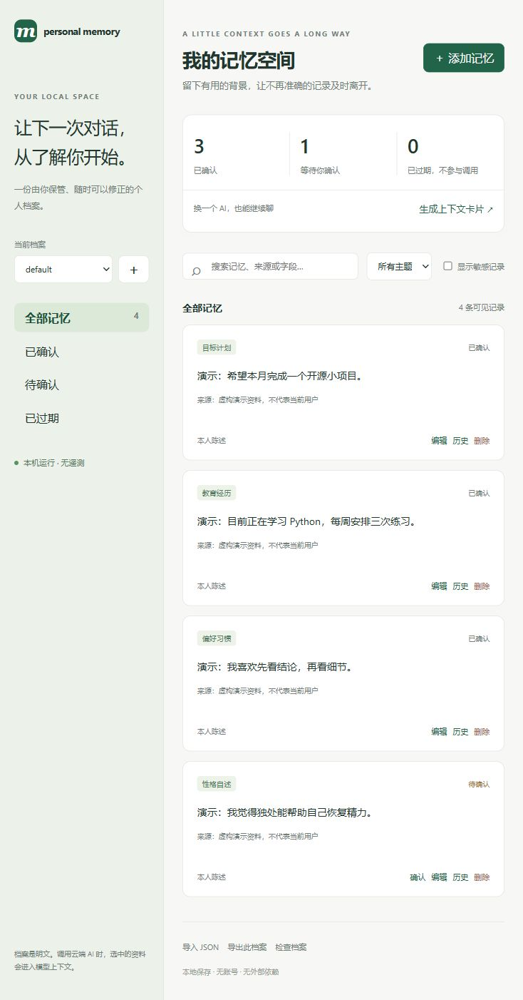

# personal-memory · 0.2

让下一次对话，从了解你开始。一份你自己保管的个人档案，一个跨聊天调用的 Codex skill，以及一个无需账号的本地管理页面。

**Python 3.10+ · 零第三方运行依赖 · 无遥测 · MIT**



## 功能

- **可视化管理**：搜索、主题与状态筛选、编辑、修正历史、删除；敏感记录默认隐藏。
- **独立档案**：将 personal、work 等场景分别保存和检索，避免工作与私人背景混用。
- **待确认收件箱**：导入资料先审核，未确认的推测不参与正式调用。
- **去重和字段冲突检查**：归一化后的相同内容跳过；同一个字段出现不同当前值时，进入待确认。字段冲突需要填写相同的 key，尚未实现语义识别。
- **会过期的记忆**：给临时目标、阶段性偏好设置有效期，过期后不参与上下文卡片。
- **可带走的上下文卡片**：按主题、关键词和字数预算生成一段背景，方便复制给其他 AI；默认排除敏感、待确认和过期记录。
- **本地备份与迁移**：JSON 导入导出，保留来源；导出不包含修正历史，导入后重新进入待确认。
- **可撤回的个人档案**：删除一条记忆时，一并删除它在数据库中的修正历史。

没有后台采集、自动同步或扫描全部聊天的功能。关键词搜索是本地文字匹配，没有远程嵌入服务或 API 依赖。管理页面启动时仅监听 127.0.0.1，停止后不再运行。

## 安装

下载并解压，安装 Python 3.10+ 后，在本目录运行：

```text
python install.py
```

升级时运行 `python install.py --upgrade`，只更新 skill 文件，不读取或复制私人资料。自定义路径用 `--target <完整的目标skill目录>`。

默认安装到 `~/.agents/skills/personal-memory/`。部分环境使用 `$CODEX_HOME/skills/`，未设置时为 `~/.codex/skills/`，可以通过 --target 指定。不要同时安装重复副本。

无需安装 skill，也可以直接体验本地管理页面：

```text
python skills/personal-memory/scripts/memory.py serve --open
```

Windows 也可双击 `Launch.cmd`。macOS/Linux 通常将命令中的 python 换成 python3。终端显示本机地址；Ctrl+C 停止服务。数据库不会写入下载的开源目录。

手工复制安装方式：

Windows PowerShell 示例，在本仓库目录运行：

```powershell
$skillParent = Join-Path $env:USERPROFILE '.agents/skills'
$skillTarget = Join-Path $skillParent 'personal-memory'
if (Test-Path -LiteralPath $skillTarget) { throw '目标已存在，请先检查，避免覆盖。' }
New-Item -ItemType Directory -Path $skillParent -Force | Out-Null
Copy-Item -LiteralPath './skills/personal-memory' -Destination $skillTarget -Recurse
```

如果新 skill 未显示，重新打开聊天或重启客户端后检查 skill 列表。

## 使用

在支持本地 skill 的 Codex 中选择此 skill，或输入：

```text
$personal-memory 初始化我的本地档案。
$personal-memory 记住：我的学校和专业是……
$personal-memory 结合我的教育背景制定学习计划。
$personal-memory 把我指定的旧聊天整理进记忆，区分自述和推测。
$personal-memory 列出保存了哪些个人资料及其来源。
$personal-memory 忘掉我上一段情感经历的记录。
$personal-memory 打开本地记忆管理页面。
$personal-memory 为另一个 AI 生成只包含教育背景的上下文卡片。
$personal-memory 检查我的临时目标是否已经过期。
```

默认不静默积累新资料。你可以明确设置范围有限的持续保存偏好，之后在该范围内无需重复确认。自动选择依赖宿主，显式调用更可靠。普通网页聊天不能直接访问这台电脑的档案。

## 私人资料位置

优先采用环境变量 `PERSONAL_MEMORY_DIR` 指定的目录，否则为：

- Windows：`%LOCALAPPDATA%/CodexPersonalMemory/`
- Linux/macOS：`${XDG_DATA_HOME:-~/.local/share}/codex-personal-memory/`

该目录必须位于 skill、开源包和 Git 仓库之外。权威数据存于 `memory.sqlite3`，安装或升级不覆盖私人资料。不同档案是检索范围的隔离，共用本机数据库，不是不同用户之间的权限隔离。

v0.1 的 Markdown 档案不会被静默导入或删除。`doctor` 会提示发现的旧文件；可让 skill 在你授权后整理迁移。空索引无需迁移。

## 导入、备份和上下文卡片

管理页面可以选择本地 JSON 文件，全部新记录进入待确认。`examples/import.example.json` 仅含明确标注的虚构示例。此版本不直接解析任意 ChatGPT/其他平台的原始聊天导出；可先让 skill 整理你授权的聊天，生成结构化候选记录后再导入。

导出按钮会下载当前档案的全部当前记录，包括隐藏的敏感记录、过期及待确认记录，不包含旧版本。导出是明文，不是加密备份；还原导入会分配新 ID 并重新审核。浏览器下载位置由浏览器设置决定，请保存在私人目录。

上下文卡片读取当前筛选条件，只包含已确认且未过期的记录。默认最多 3000 字符，超过预算会保留完整条目并报告省略数量，字符数不是 token 数。敏感内容只在你明确启用时加入。

完整命令及数据格式见 [commands.md](skills/personal-memory/references/commands.md)。

## 隐私边界

**本地保存不等于本地推理。** 使用云端模型时，读入上下文的资料会随模型请求被处理，聊天及工具输出也可能包含它。本项目不能保证资料不离开电脑、零服务端留存或不被用于训练。若要求资料始终不出设备，需要本地模型和经过验证的离线执行环境。

档案是明文 SQLite，没有实现加密或独立访问控制。skill 规则不能阻止有文件权限的其他程序读取资料。选择非云盘同步目录，按需使用操作系统权限、磁盘加密及备份。管理页面不请求外部资源，API 使用每次启动生成的令牌与来源检查；这些机制不防御拥有本机文件权限的程序。

删除针对该档案，不同时删除旧聊天、工具日志、系统备份或内置 Memories。性格记录要保留来源和不确定性，不能将短期情绪或模型推测固化为事实。

## 内置 Memories

Codex 已有独立的本地 Memories，从符合条件的聊天在后台生成记忆。本 skill 提供可直接维护、按主题调用的个人档案；它不修改内置记忆，也不承诺完整保留所有历史。

## 开源

本目录包含规则、标准库工具、本地页面、测试、虚构示例及 MIT 许可证，可以作为公开仓库的起点。真实资料放在外部目录，不能作为示例、截图、测试或 issue 附件。发布前检查要提交的文件与历史；`.gitignore` 无法清除已跟踪或提交的资料。

公开仓库只分发通用代码、文档、测试与虚构示例。个人档案始终保存在使用者自己的外部目录。

## 验证与反馈

```text
python -m unittest discover -s tests -v
```

测试使用隔离的虚构数据，覆盖跨档案访问、去重、导入事务、过期与敏感过滤、字段冲突、并发纠错、删除历史、HTTP 来源与令牌检查、安装升级。提交问题时请使用虚构数据复现，勿附真实档案。

## 官方参考

- [Skills：调用和本地目录](https://learn.chatgpt.com/docs/build-skills)
- [Memories：设置和本地存储](https://learn.chatgpt.com/docs/customization/memories)

MIT 许可适用于本仓库规则和代码，不授予任何人的私人资料使用权。
